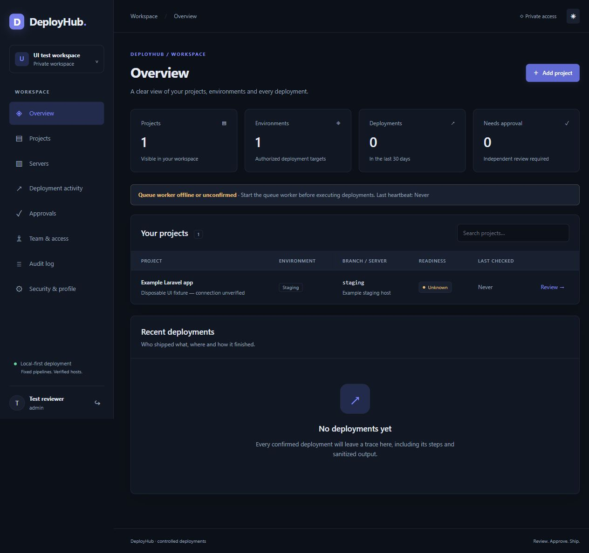

# Verification record

Latest local verification: 11 October 2026, Asia/Kuala_Lumpur. Earlier browser and installation checks are retained below with their original scope.

## Recorded results

| Check | Result |
|---|---|
| Full PHP suite | **151 tests passed, 1035 assertions**. Includes authorized summary projections across full history, unified review/confirmation timing, scheduled deployment lifecycle, canonical JSON/legacy digest compatibility, preflight reuse/invalidation, batched inspection framing, independent project lifecycle, workflow, access/MFA, approvals/recovery, real Git and worker concurrency. |
| Project summary/access regression | **24 tests passed, 338 assertions** in the focused listing/lifecycle/access run. A later failed deployment remains visible despite 51 newer previews, last success is separate, drafts/cancelled previews do not replace the summary, pending work does not claim success, summary projections exclude snapshots/preflight/email, statistics query full authorized history, and ungranted members receive no projects/counts. |
| Project/deployment UX browser review | Actual Index, Environment and Deployment Vue pages rendered with labelled in-memory data. Desktop lists, overview links, historical-success/cached-inspection distinctions, collapsed repository details and Copy project entry inspected. Review defaults to Deploy now; choosing Schedule and returning clears confirmation. Simulated Schedule submission displayed 12 October 2026 23:15 Asia/Kuala_Lumpur. Running-step polling transitioned to failed, opened failed output, retained collapsed successful output and marked future verification Not Run. Recovery review omitted Git update; Unknown exposed reconciliation rather than recovery. At 390px, project list, project home and review stayed within the viewport; the confirmation anchor worked. Final browser logs had no warnings/errors. Ignored screenshots: `storage/app/ui-projects-2026-10-11.png` and `storage/app/ui-deployment-2026-10-11.png`. Temporary preview files/server/tab removed and viewport reset. No real SSH action, deployment or schedule was created. |
| MySQL summary smoke check | Read-only eager loading of latest-deployment and last-success relations succeeded on the existing installation. Only counts were printed; no data or credentials were changed. |
| Scheduled deployment regression | Fifteen scheduled tests passed in the full suite. The final combined scheduling/execution/recovery/listing run passed **54 tests, 500 assertions**. Covers UTC/timezone validation, immutable time, no early enqueue/reservation, independent production approval, fresh requester/approver/MFA/configuration checks, busy/unknown targets, cancellation/archive, missing approval/expired windows, atomic enqueue rollback, duplicate dispatch, early-worker rejection and exclusion of approvals past their scheduled deadline without a running scheduler. New confirmation cases pin the existing exact commit without SSH, retain immutable source fields, prevent conflicting/duplicate plans and immediate reuse of a replaced review, preserve production approval and roll back source cancellation plus candidate creation/confirmation together. |
| Workflow/lifecycle/registry regression | **19 tests passed, 153 assertions** in the combined focused run. Independent copy/access/history, active/locked deletion, target separation, typed reset/health, canonical scripts, frozen content, hook phase order, failures and permissions. Additional archived-activity/confirmation assertions passed in the subsequent six-test Registry run. |
| Host-trust/access/safety regression | **23 tests passed, 136 assertions**. Covers explicit first-use confirmation, independent replacement of saved keys, expiry, changed host/configuration, concurrent pinning, workspace/admin/MFA boundaries and existing access/credential protections. |
| Recovery/listing coverage | Passed within the full suite: fresh production approval, revoked access/configuration, paginated lists, literal search, independent registrations and explicit server access transfer. |
| Real Git integration with guarded cleanup | Eleven cases passed in the full suite. A final additional real-Git regression passed for tracking-ref movement during a batch: target/count/commit list stay bound to the captured SHA. Exact-SHA deployment was also rerun after final batching changes. All disposable fixtures cleaned themselves. |
| `npm run build` | TypeScript check and Vite production build passed. |
| `php vendor/bin/pint --test` | Passed. |
| `npm run format:check` | Passed. |
| `composer validate --no-check-publish` | Installation verification recorded a valid manifest; not rerun for these repairs. |
| `composer audit` / `npm audit` | Installation verification recorded no advisories; not rerun for these repairs. No package constraints or lockfiles changed. |
| MySQL migrations | All nine migrations applied. The new schedule migration adds nullable time/timezone columns and a due-state index; existing records remain immediate. Earlier additive project separation converts selected legacy actions to workflow options and adds archive fields and active path/one-target constraints. Its before/after audit confirmed target settings, grants, users, credentials and deployment/step/approval records unchanged. No live schedule was created or dispatched for verification. |
| Local HTTP smoke check | Sign-in renders at loopback `http://127.0.0.1:8018`; application name/version/runtime verified. |
| Browser review | Disposable MFA sign-in; pending approval behind 50 newer records; activity filters including literal `%`; failed recovery controls; duplicate-name validation; server transfer warning; history page three preserving its tab. Selected checkbox appearance and sizing inspected; no browser console errors observed. |
| Host-trust browser review | The actual Vue Servers page rendered with disposable in-memory preview responses. Desktop/mobile layout, both confirmation choices, first-use save enabling authentication, and removal of first-use choices for saved fingerprints inspected. No live server credentials, trust records or SSH connections were used. |
| Workflow browser review | Actual Vue Copy project, Environment and Deployment pages rendered with in-memory fixtures. Default Hard reset unchecked; custom hook creation/enabling/order and health URL visibility inspected. Copy/Delete entry points and review of dirty paths, reset script, exact commits and planned steps verified. No console warnings/errors on final preview. Screenshot retained as an ignored local artifact; no real SSH commands executed. |
| Initial schedule/compact-workflow browser review | Actual Environment and Deployment Vue pages rendered with in-memory preview responses. Commands default collapsed, expand correctly, and custom-hook script content survives collapse/reopen. New hooks open automatically. Scheduled review converted `2026-10-12T23:15` in Asia/Kuala_Lumpur to `2026-10-12T15:15:00.000Z` and displayed the same chosen local time. A 390px viewport revealed action-button overflow, fixed by wrapping. This earlier separate Schedule-tab UI has since been replaced by the unified flow below. No live schedule/job or remote SSH action was created. |
| Unified deployment browser review | Actual Environment and Deployment Vue pages rendered with disposable in-memory preview responses. Project offers Prepare deployment and has no Schedule button/tab. Review defaults to Deploy now; Schedule reveals date/time, and returning to Deploy now hides it, clears review confirmation and submits only reviewed/digest. Schedule confirmation sends the same reviewed digest plus UTC instant/timezone, reaches Scheduled on the replacement record and displays the chosen local date. Existing Deployments history displays Scheduled and its date. Native radio styling was repaired; final 390px document stays within its viewport. The empty console is absent before confirmation. Final console logs contain no warnings/errors. Ignored screenshot: `storage/app/unified-deployment-preview.png`. Temporary server, tabs and preview files were removed; viewport reset. No live deployment was scheduled or run. |
| Disposable browser cleanup | Scoped review users, workspace, projects, unverified servers, deployment records and sessions removed. Real users and targets were not used. |
| Worker/scheduler | Browser displayed offline/unconfirmed heartbeat during these checks. No real deployment was queued or executed. Automated worker/concurrency checks use isolated fixtures. |
| Schedule registration/runtime | `artisan schedule:list` lists dispatch every minute alongside reconciliation/daily pruning; all nine migrations are applied. Local sign-in HTTP smoke check returned 200. A graceful queue restart signal was issued after implementation; manually managed workers and `schedule:work` must be started/restarted with current code. |
| Agent rule validation | Root `AGENTS.md` inventory matches five active `.agents/rules` files: two global and three conditional. Local Laragon/PowerShell preferences are ignored; no second active rule system exists. |
| Secret/source check | `.env` and initial-login file are ignored. No SSH key, database fixture or initial password is included in the Git file list. |

These are separate recorded runs; assertion counts must not be added together as independent coverage.

See [Repair validation](FIXES_2026-10-09.md) for the resolved findings and [Rule bootstrap report](../.agents/logs/BOOTSTRAP_REPORT.md) for skill suitability and instruction validation.

## Commands

```powershell
php -d extension=pdo_sqlite -d extension=sqlite3 vendor/bin/phpunit
php -d extension=pdo_sqlite -d extension=sqlite3 vendor/bin/phpunit --filter 'DeployHub|Registry|Worker|TwoFactor'
php -d extension=pdo_sqlite -d extension=sqlite3 vendor/bin/phpunit --filter DeployHubAccessTest
php -d extension=pdo_sqlite -d extension=sqlite3 vendor/bin/phpunit --filter RealGitDeploymentTest
npm run build
php vendor/bin/pint --test
npm run format:check
composer validate --no-check-publish
composer audit
npm audit
php artisan migrate:status
```

## Preview

The screenshot uses labelled disposable UI data, with an unverified/unknown target. It does not represent a real connected server or a completed deployment. That data was removed after review.



## Remaining acceptance work

Actual SSH transport, cPanel noninteractive PATH, Git origin authentication and an HTTPS health check must still be exercised on a disposable real host. No production host was contacted. Team/VPN/HTTPS deployment, mail delivery, backups/restoration and an installation-specific security go/no-go remain milestone 6 work.

Automatic approval review rejected recursive shell deletion of older Git fixture directories with “blocked by policy.” Those earlier directories remain ignored under `storage/framework/testing`. This does not affect the application or source-control contents. Newly created integration fixtures now verify successful teardown.

## Preflight performance repair

- Normal inspection uses two remote exec batches rather than eleven commands. Enabled Pre hooks add at most two content-hash batches. Successful configuration-matching preflight can be reused for 120 seconds by Review; explicit Refresh, recovery and worker inspection remain fresh.
- The final focused run passed **14 tests, 42 assertions**, covering JSON object-key normalization, unchanged legacy digests, ordered-hook changes, cache invalidation, stale remote tips, binary/malformed batch frames and concurrent tracking-ref movement. These overlap the full-suite coverage; counts are not additive.
- A read-only MySQL `SELECT CAST(... AS JSON)` roundtrip confirmed canonical digest stability without inserting data. The latest existing unexpired candidate passed local validation despite reordered JSON keys. Candidate/credential records were not modified.
- The real Environment Vue page rendered with disposable in-memory data and the normal responsive-table directive. Inspection duration and reuse guidance were visible; final browser logs had no warnings/errors. The displayed 1.3s is fixture data, not a real-host timing result.
- Frontend build/type checks, Prettier, Pint and local HTTP sign-in smoke check passed. A queue restart signal was issued; manually managed workers must be started again. No actual target SSH command or deployment was run for verification.
